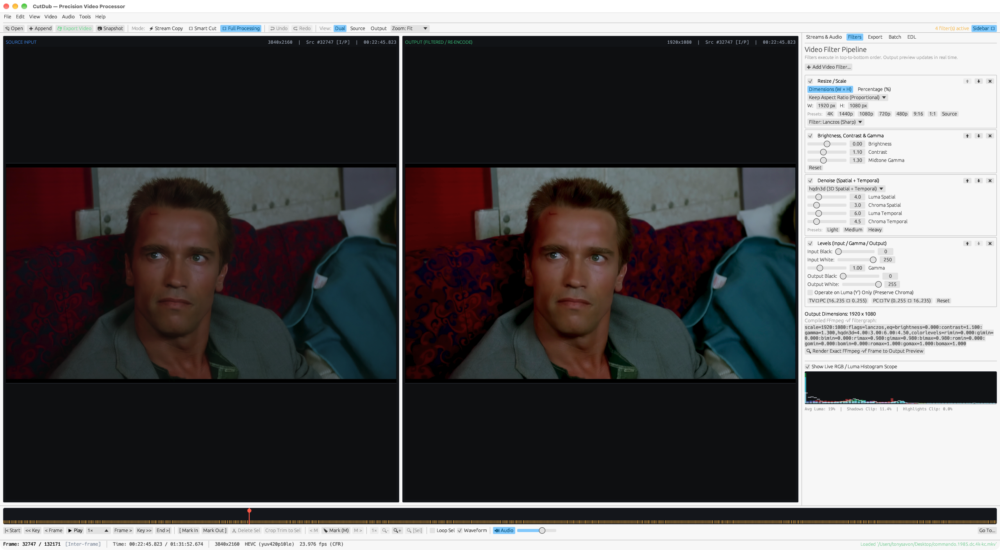

# CutDub — Precision Video Processor

<p align="center">
  <a href="https://github.com/tonysavon/CutDub/actions/workflows/ci.yml"></a>
  <a href="https://github.com/tonysavon/CutDub/releases"></a>
  <a href="LICENSE"></a>
  
  
</p>

**CutDub** (also known as **ReDub**) is a modern, open-source, cross-platform successor to **VirtualDub2**, written in Rust with a hardware-accelerated `egui` / `eframe` (`wgpu`) desktop interface and powered by **FFmpeg**.

Unlike heavy non-linear editing suites (Premiere Pro, DaVinci Resolve), CutDub is engineered as an ultra-fast, lightweight, keyboard-driven utility focused on frame-accurate navigation, instantaneous lossless stream cutting, smart partial GOP re-encoding, and real-time filtered video processing.

---

<p align="center">
  
</p>

---

## Downloads (v0.1.1)

Pre-built standalone releases are available on the [**GitHub Releases page**](https://github.com/tonysavon/CutDub/releases/tag/v0.1.1):

| Platform | Architecture | Package |
| :--- | :--- | :--- |
| **macOS** | Apple Silicon (`arm64`) | [**`CutDub-0.1.1-macos-arm64.tar.gz`**](https://github.com/tonysavon/CutDub/releases/download/v0.1.1/CutDub-0.1.1-macos-arm64.tar.gz) |
| **macOS** | Intel (`x86_64`) | [**`CutDub-0.1.1-macos-x86_64.tar.gz`**](https://github.com/tonysavon/CutDub/releases/download/v0.1.1/CutDub-0.1.1-macos-x86_64.tar.gz) |
| **Windows** | 64-bit (`x86_64`) | [**`CutDub-0.1.1-windows-x86_64.zip`**](https://github.com/tonysavon/CutDub/releases/download/v0.1.1/CutDub-0.1.1-windows-x86_64.zip) |
| **Linux** | 64-bit (`x86_64`) | [**`CutDub-0.1.1-linux-x86_64.tar.gz`**](https://github.com/tonysavon/CutDub/releases/download/v0.1.1/CutDub-0.1.1-linux-x86_64.tar.gz) |

> [!NOTE]
> - CutDub requires **FFmpeg** and **ffprobe** installed on your system or in your `PATH`.
> - Checksum verification hashes are provided in [`SHA256SUMS.txt`](https://github.com/tonysavon/CutDub/releases/download/v0.1.1/SHA256SUMS.txt).
> - On macOS, release builds use an ad-hoc signature and are not notarized. After verifying the download, you may need to remove its quarantine flag:
>   ```bash
>   xattr -cr /path/to/CutDub.app
>   ```

---

## Key Features

- **Frame-Accurate Navigation & Scrubbing**:
  Frame navigation across Constant Frame Rate (CFR) and Variable Frame Rate (VFR) streams using 64-bit microsecond timestamps (`TimestampUs`) and FFmpeg rational time bases. Explicit identification of Keyframes (`[K]`), Intra/Predicted frames (`[I/P]`), and Bi-directional frames.
- **Lossless Direct Stream Copy (`-c:v copy`)**:
  Instantaneous lossless export without quality loss or re-encoding. Automatically validates GOP structure and keyframe boundaries, warning you if an in-point falls on a delta frame to avoid corrupt lead-in artifacts.
- **Smart Cut / Smart Rendering (`SmartCopy`)**:
  Frame-accurate cutting without re-encoding the entire video! Only re-encodes the tiny partial lead-in GOP up to the next keyframe, then copies the rest of the stream without re-encoding. Export speed depends on the media and storage.
- **Real-Time Video Filter Pipeline**:
  Composable, reorderable filters executing live in the UI and compiling directly to FFmpeg `-vf` filtergraphs:
  - **Resize / Scale**: Lanczos (Sharp), Bicubic, Bilinear, Spline, with 4K, 1440p, 1080p, 720p, 480p, 9:16 vertical, and 1:1 square presets with aspect ratio preservation.
  - **Brightness, Contrast & Midtone Gamma** correction.
  - **Spatial & Temporal Denoise (`hqdn3d`)**: High-performance noise reduction with independent luma/chroma spatial/temporal thresholds and presets (Light, Medium, Heavy).
  - **Levels & Dynamic Range**: Input/Output black/white clipping, gamma correction, PC (0–255) vs TV (16–235) broadcast range conversion, and luma-only preservation.
  - **Interactive On-Canvas Crop Handles**, Flip (H/V), Rotate (90°/180°/270°), and Deinterlace (YADIF).
- **Dual-View Side-by-Side Comparison**:
  Simultaneous side-by-side display of the unmodified **Source Input** vs the live **Output (Filtered / Re-encode)** preview.
- **Live Scopes & Telemetry**:
  Real-time RGB and Luma histogram scope with live shadow/highlight clipping percentage detection and average scene luminance indicators.
- **Continuous Streaming Playback & Live Audio**:
  Persistent backpressure-paced FFmpeg streaming pipe paired with high-performance `rodio` audio output for buffered playback, including files on external storage. Performance depends on the codec, filters, hardware, and storage.
- **Non-Destructive Edit Decision List (EDL)**:
  Mark In / Mark Out selection, Trim to Selection, Delete Range, Append Segments, Timeline Bookmarks (`Mark`), and infinite Undo/Redo (`Cmd/Ctrl+Z` / `Cmd/Ctrl+Y`).
- **Multi-Track Audio & Subtitle Stream Control**:
  Select, mute, extract, delay-adjust, or re-encode individual audio tracks with live delay synchronization (`ms`).
- **Batch Processing & Headless CLI**:
  Queue multiple encoding tasks or drive headless automation scripts (`.cutdub-script.json`) via terminal or CI runners.

---

## Keyboard Shortcuts

CutDub is designed for rapid keyboard-driven editing:

| Shortcut | Action |
| :--- | :--- |
| `Space` | Play / Pause |
| `Left` / `Right` | Step backward / forward 1 frame |
| `Shift + Left` / `Shift + Right` (or `PgUp` / `PgDn`) | Jump to previous / next keyframe (`[K]`) |
| `Alt + Left` / `Alt + Right` | Step backward / forward 10 frames |
| `Home` / `End` | Jump to start / end of timeline |
| `[` or `I` | Set selection start (**Mark In**) |
| `]` or `O` | Set selection end (**Mark Out**) |
| `Delete` / `Backspace` | Delete selected range from timeline |
| `Cmd/Ctrl + T` | Trim timeline to active selection |
| `M` | Add / Toggle bookmark at current frame |
| `Shift + M` / `Alt + M` | Jump to previous / next bookmark |
| `Cmd/Ctrl + Z` | Undo edit operation |
| `Cmd/Ctrl + Y` / `Cmd/Ctrl + Shift + Z` | Redo edit operation |
| `Cmd/Ctrl + O` | Open video file |
| `Cmd/Ctrl + E` | Open Export dialog |
| `Cmd/Ctrl + G` | Go to exact frame number or timestamp |
| `Cmd/Ctrl + F` | Open Video Filters inspector |

---

## Export Presets

The preset menu shows templates whose required encoders are detected in the installed
FFmpeg build. VVC requires FFmpeg's native `libvvenc` encoder or a working external
`vvencapp`; a missing or broken external executable is not advertised as available.

Templates include stream copy, smart cut, high-quality and fast H.264, 4 Mbps H.264
sharing, high-quality and compact HEVC, VVC, AV1 WebM with Opus audio, high-quality and compact AV1
in MKV, and lossless FFV1/FLAC archival. The selector shows the loaded preset name and displays **Custom** when its settings are changed. AV1 templates prefer `libsvtav1` and fall
back to `libaom-av1` when available. The bundled VP9 WebM template has been replaced
with AV1. Custom saved presets remain intact, and newly added templates are merged
into existing preset collections.

---

## Navigation Performance Diagnostics

Paused navigation keeps a rolling frame buffer and prepares up to three upcoming
10-frame or keyframe targets in the last keyboard navigation direction. Speculative
keyframe decoding runs after the rolling buffer is full and is cancelled by a new seek.
Predictions stay within the current source clip; edits spanning other sources may still
require an uncached seek.

Open **Tools → FFmpeg Capabilities & Cache Telemetry...** for the latest preview
preparation time, split into frame wait, filters, histogram, and texture preparation.
Keyboard measurements start when the input is handled. These are CPU timings:
frame wait includes polling, and texture preparation includes conversion and queueing,
not GPU upload or screen presentation.

To log individual paused-navigation samples, including whether the frame was already
cached on its first request:

```bash
RUST_LOG=redub_app=debug cargo run --release --bin cutdub
```

---

## Prerequisites & Building from Source

### Prerequisites
1. **Rust stable toolchain** (stable, via [rustup](https://rustup.rs/))
2. **FFmpeg & ffprobe** (`ffmpeg` and `ffprobe` in `PATH` or configured via `CUTDUB_FFMPEG` / `CUTDUB_FFPROBE`)

### macOS (Apple Silicon & Intel)

```bash
# Install FFmpeg via Homebrew
brew install ffmpeg

# Build and run in release mode
cargo run --release --bin cutdub

# Run all workspace unit and integration tests
cargo test --workspace
```

### Linux (`x86_64`)

```bash
# Ubuntu / Debian dependencies
sudo apt-get update
sudo apt-get install -y ffmpeg build-essential pkg-config \
    libxcb-render0-dev libxcb-shape0-dev libxcb-xfixes0-dev \
    libxkbcommon-dev libssl-dev libgtk-3-dev libasound2-dev

# Build and run
cargo run --release --bin cutdub
```

### Windows (`x86_64`)

```powershell
# Install FFmpeg via Winget
winget install Gyan.FFmpeg

# Build and run
cargo run --release --bin cutdub
```

---

## Headless CLI & Automation Scripting

In addition to the desktop GUI, `cutdub` supports headless media inspection and declarative automation scripts (`.cutdub-script.json`):

```bash
# Inspect streams, keyframes, and VFR/CFR timing directly from the terminal
cargo run --release --bin cutdub -- --probe path/to/video.mp4

# Execute a saved CutDub automation workflow script headlessly
cargo run --release --bin cutdub -- --script workflow.cutdub-script.json
```

---

## Workspace Architecture

CutDub is organized as a modular Cargo workspace:

| Crate | Responsibility |
| :--- | :--- |
| [`crates/redub-app`](crates/redub-app) | Application entry point (`cutdub` and `redub` binaries) and `egui`/`eframe` (`wgpu`) dark-themed desktop GUI. |
| [`crates/redub-core`](crates/redub-core) | 64-bit microsecond timestamps (`TimestampUs`), rational time bases (`Rational`), VFR/CFR `FrameTimingMap`, non-destructive `Project` EDL, stream configs, and Undo/Redo history. |
| [`crates/redub-media`](crates/redub-media) | `ffprobe` metadata & stream inspection, fast packet-header PTS/keyframe indexing, dynamic FFmpeg encoder/hwaccel capability detection, and keyframe-assisted burst frame decoding. |
| [`crates/redub-preview`](crates/redub-preview) | Bounded LRU `FrameCache`, wall-clock synchronized VFR/CFR `PlaybackClock`, and non-blocking background frame decode worker (`PreviewEngine`). |
| [`crates/redub-filters`](crates/redub-filters) | Serializable, composable, reorderable `FilterPipeline` (`Crop`, `Resize`, `Rotate`, `Flip`, `BrightnessContrast`, `ColorAdjust`, `Deinterlace`) with FFmpeg `-vf` compilation and real-time preview processing. |
| [`crates/redub-export`](crates/redub-export) | Asynchronous background export runner with Direct Stream Copy, Full Processing, Smart Cut, multi-segment EDL concatenation, real-time progress telemetry, and encoding presets. |
| [`crates/redub-platform`](crates/redub-platform) | Cross-platform OS integration, configuration/cache directories (`AppPaths`), persistent `AppSettings`, and `ffmpeg`/`ffprobe` binary discovery. |

---

## Packaging Release Binaries

To produce standalone release bundles:

- **macOS (`CutDub.app` bundle + `.tar.gz`):**
  ```bash
  ./scripts/package-macos.sh 0.1.1
  ```
- **Linux (`.desktop` + portable `.tar.gz`):**
  ```bash
  ./scripts/package-linux.sh 0.1.1
  ```
- **Windows (portable `.zip`):**
  ```powershell
  powershell -ExecutionPolicy Bypass -File scripts\package-windows.ps1 -Version 0.1.1
  ```

Output archives are created in `releases/<version>/`.

---

## Documentation

- [Architectural Decisions & ADRs (`docs/ARCHITECTURE.md`)](docs/ARCHITECTURE.md)
- [Development Roadmap & Milestones (`docs/ROADMAP.md`)](docs/ROADMAP.md)

---

## License

CutDub is licensed under the [GNU General Public License v3.0 or later (GPL-3.0-or-later)](LICENSE).
